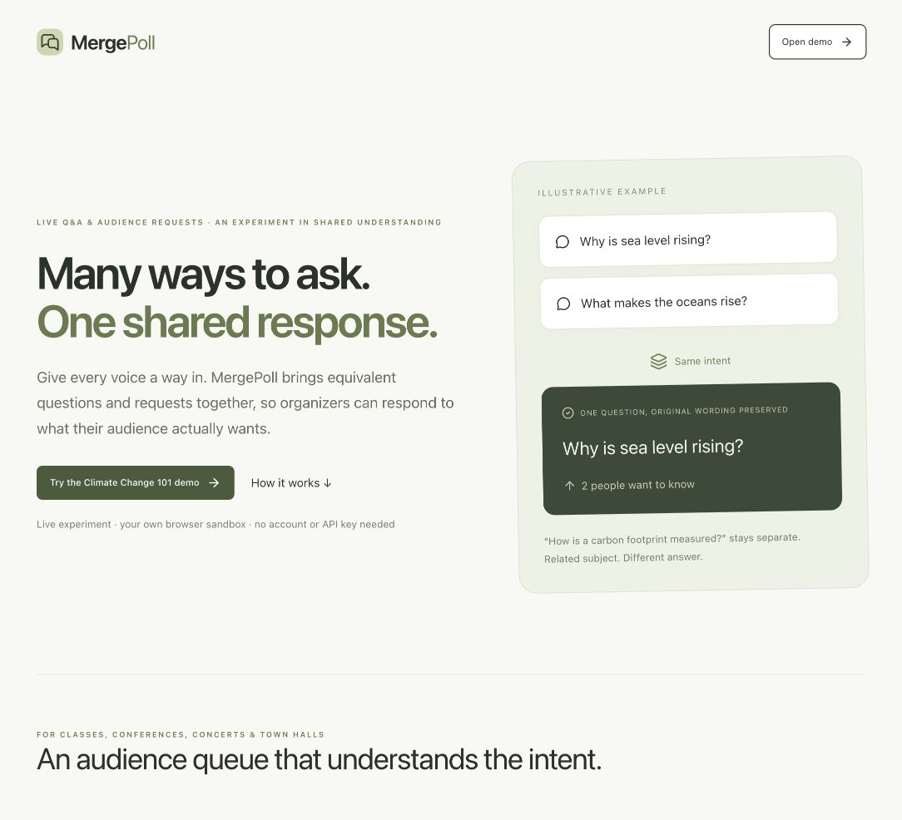
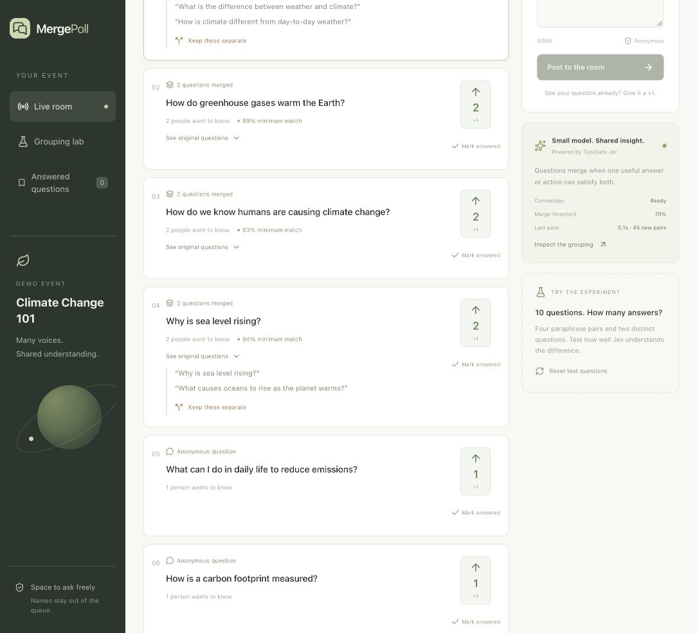

<p align="center">
  
</p>

<p align="center">
  A live audience queue that brings overlapping questions and requests together.<br />
  Ask freely. Support a question. Give one useful response to several people.
</p>

<p align="center">
  <a href="https://github.com/perperwtl/MergePoll/actions/workflows/ci.yml"></a>
  <a href="LICENSE"></a>
  
  
</p>

<p align="center">
  <a href="https://mergepoll.newreed128.chatgpt.site/">Live demo</a> ·
  <a href="#quick-start">Run with Docker</a> ·
  <a href="#try-the-experiment">Try the experiment</a> ·
  <a href="docs/SELF_HOSTING.md">Self-host</a> ·
  <a href="docs/ROADMAP.md">Roadmap</a> ·
  <a href="CONTRIBUTING.md">Contribute</a> ·
  <a href="docs/LICENSING.md">License guide</a>
</p>

## Why MergePoll?

For a visual introduction, open the [project website](https://perperwtl.github.io/MergePoll/).
It includes interactive examples of the shared-answer rule.
The website source and publication steps are in [the GitHub Pages guide](docs/GITHUB_PAGES.md).

Audience questions often arrive in different words but need the same response.
MergePoll asks **“Would one concise, useful answer or action satisfy both?”**
It preserves original wording and gives the organizer control over mistakes.

| Audience input | Intended behavior |
| --- | --- |
| “Will climate change affect ocean life?” + “How does climate change affect ocean life?” | Can merge: explaining the effects naturally answers both |
| “How does climate change affect ocean life?” + “What can we do to protect ocean life?” | Stay separate: effects and protective actions need different responses |
| “One more song, please” + “Play an encore” | Can merge when the event context supports the same action |
| Requests for two different songs | Stay separate |

These are intended behaviors, not guaranteed predictions. Model decisions can
be wrong; inspect and split groups when needed.



## What you can do today

- **Ask and support:** post questions or requests without displaying your name,
  or give an existing question a +1.
- **Merge by shared response:** TypeSafe Jev evaluates pairs; every pair in a
  group must clear the selected threshold. The default is 0.7.
- **Keep the organizer in control:** inspect original questions, split a group,
  mark it answered and reopen it later.
- **See the experiment:** inspect probabilities, request timing and model usage
  in the grouping lab. Cached decisions avoid repeat comparisons.
- **Switch language:** the interface is available in English and Simplified
  Chinese.
- **Skip idle work:** cycles with no new questions show “No new questions” and
  avoid calling the model.
- **Run independently:** local D1 storage and an optional organizer token;
  self-hosting does not require ChatGPT or the original Sites deployment.

Suitable starting points include lectures, workshops, community meetings and
small event Q&A sessions. Concert requests are an experimental use case.

## Quick start

You need **Docker Desktop** (Windows/macOS) or **Docker Engine with Compose v2.24+**
(Linux), plus Git. Docker Desktop must include Compose v2.24 or newer.
No host Node.js, npm, database setup or Cloudflare account is needed.

```bash
git clone https://github.com/perperwtl/MergePoll.git
cd MergePoll
docker compose up --build -d
```

Open **http://localhost:5173**. Docker installs dependencies, builds the app and
applies local database migrations automatically. The first room request creates
ten Climate Change 101 questions. Data stays in a named volume across restarts.

**To enable real grouping:** copy `.env.example` to `.env`, add your own
`TYPESAFE_API_KEY`, then run `docker compose up -d` again. Browsing, posting,
voting and answering work without a key. Docker reads credentials only from
this checkout’s `.env`, not from your shell’s `TYPESAFE_API_KEY`. The app shows
a setup notice until you configure a key. No key or API credits are included
in the image. Questions and event context go to TypeSafe when you group.

Optionally set a long random `ORGANIZER_TOKEN` in `.env` to test organizer login.
The default port is accessible only on your computer. See
[Docker setup, backups and troubleshooting](docs/SELF_HOSTING.md).

## Live experiment — no setup

Try [a blank task](https://mergepoll.newreed128.chatgpt.site/new) or the climate walkthrough.

**[Open the live MergePoll demo](https://mergepoll.newreed128.chatgpt.site/)**
— no self-hosting, account or personal API key required.

1. Enter the Climate Change 101 demo; your browser gets its own sandbox.
2. Click **Group now**, inspect originals and open **Grouping lab**.
3. Switch to Participant to post or vote, then Organizer to split or mark answered.

Create a custom task to get a **shareable participant link** to the same queue.
Each browser can have **one active custom task**, lasting **24 hours**, with a
visible countdown and automatic cleanup after expiry. The creator's browser
cookie retains organizer access; no login is needed. Clearing cookies can bypass
this browser limit. The climate walkthrough remains a private browser sandbox.

Hosted tasks allow **100 total questions**, **500 characters per question**, and
**40 live grouping attempts**, at least one minute apart. Custom tasks default
to a three-minute cycle while the Organizer view stays open, covering a 90-minute
class with headroom. Idle and cached checks do not spend attempts. Shared daily
budgets are **500 attempts and 100,000 new pair comparisons (UTC)**.
Read [live limits and retention](docs/LIVE_DEMO.md) for the full policy. Docker
has no app-imposed count quota or automatic expiry.

## Try the experiment

1. Open `/room` in Organizer view. Keep this tab open for automatic cycles.
2. With a TypeSafe key configured, click **Group now**.
3. Expand **See original questions**, then open **Grouping lab** to inspect scores.
4. Try a broader/narrower question pair, or a related pair needing different answers.
5. Use **Keep these separate** to correct a merge; use **Mark answered** and **Reopen**.
6. Open `/room?view=participant` in another browser or private window to try posting
   and voting with a separate browser identity.

**Reset test questions** replaces the room's questions, votes, answered history
and grouping history with the original ten examples; it asks for confirmation.



The screenshot above is from the live hosted demo; exact scores and
grouping results vary with input and model behavior.

The seed set has four paraphrase pairs and two other questions. Its labels test
paraphrases; the current policy also permits broader/narrower answer overlap.
The lab's tiny sample is a sanity check, **not a general accuracy benchmark**.

## Current limits

This is an experimental prototype, with:

- **One shared room in Docker**, with no application question-count or
  grouping-attempt quota. Hosted tasks have the limits above. Each post is
  limited to 500 characters.
- Automatic grouping while an authenticated Organizer view is open; no background
  server scheduler.
- Supporters deduplicated by browser token, not verified people.
- Pairwise comparison that grows with question count; large-event scalability
  has not been demonstrated.
- No built-in moderation queue, QR generator or multi-event management; Docker
  has no retention policy (hosted tasks are deleted after 24 hours).
- Questions anonymous in the displayed queue, not guaranteed anonymous to the
  host or model provider. See [SECURITY.md](SECURITY.md).

## Development

Develop the application with your editor or coding agent, then rebuild Docker
with `docker compose up --build -d`. Run contributor checks using the
[Docker build stage](docs/SELF_HOSTING.md#development-checks-in-docker).
Docker is the supported setup for running your own copy. The hosted demo is
provided so visitors can try the application quickly.

Tests use synthetic data and do not require a key or call TypeSafe. CI runs these
checks on pushes and pull requests.

| Location | Purpose |
| --- | --- |
| `app/page.tsx` | Product introduction |
| `app/room/page.tsx` | Organizer and participant UI |
| `app/new/page.tsx` | Task setup |
| `app/api/room/route.ts` | Shared room state and actions |
| `app/api/organizer/route.ts` | Organizer login and logout |
| `lib/grouping.ts` | Jev request, cached scores and clustering |
| `lib/merge-policy.ts` | Policy migration |
| `lib/organizer-auth.ts` | Signed organizer sessions |
| `migrations/` | D1 schema |
| `Dockerfile`, `compose.yaml`, `docker/` | Container build, persistent storage and automatic setup |
| `lib/demo-session.ts` | Visitor sandbox sessions and hosted demo limits |
| `lib/shared-task.ts`, `app/api/tasks/cleanup/route.ts` | Hosted 24-hour tasks and expiry cleanup |
| `lib/translations.ts`, `app/language.tsx` | English and Simplified Chinese interface text |

The stack is React, TypeScript, Tailwind CSS, Vinext/Vite and Cloudflare Workers
with D1. See [how grouping works](docs/HOW_IT_WORKS.md).

## Help shape the project

Have an example that should merge, or a mistaken merge? Submit a
[grouping example](https://github.com/perperwtl/MergePoll/issues/new?template=grouping_example.yml).
For bugs and ideas, use the [issue forms](https://github.com/perperwtl/MergePoll/issues/new/choose).
Code contributions follow [CONTRIBUTING.md](CONTRIBUTING.md) and require explicit
acceptance of the contribution agreement so commercial licensing remains possible.

To introduce MergePoll to others, use the [sharing kit](docs/SHARING.md): a short
pitch, demo walkthrough and suggested pilot questions.

## License

Copyright (c) 2026 perperwtl.

Licensed under [AGPL-3.0-only](LICENSE). Personal, institutional and commercial
use is permitted under AGPL. Distributed covered modifications must provide
corresponding source under AGPL; modified versions offered over a network must
prominently offer their corresponding source to interacting users.

For alternative licensing inquiries, open a [GitHub Issue](https://github.com/perperwtl/MergePoll/issues).
Alternative licensing is subject to a separate agreement; an inquiry does not
grant an exemption from AGPL. Third-party dependencies retain their own licenses.
See the [license guide](docs/LICENSING.md) for details.
