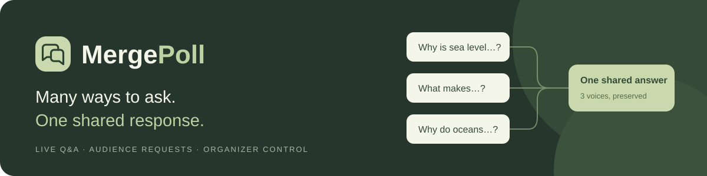
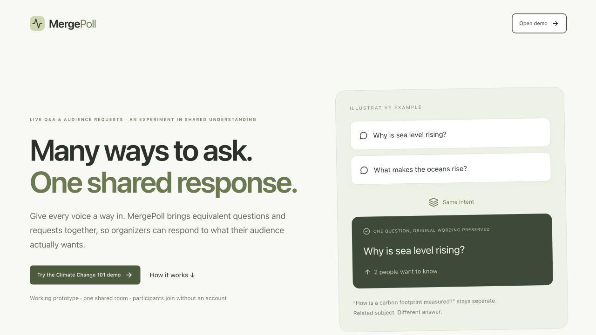
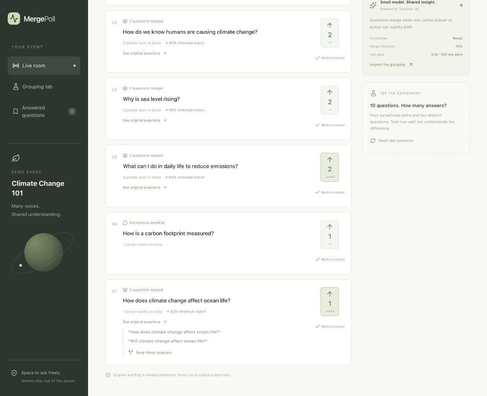

<p align="center">
  
</p>

<p align="center">
  A live audience queue that brings overlapping questions and requests together.<br />
  Ask freely. Support a question. Give one useful response to several people.
</p>

<p align="center">
  <a href="https://github.com/perperwtl/MergePoll/actions/workflows/ci.yml"></a>
  <a href="LICENSE"></a>
  
  
</p>

<p align="center">
  <a href="#quick-start">Run locally</a> ·
  <a href="#try-the-experiment">Try the experiment</a> ·
  <a href="docs/SELF_HOSTING.md">Self-host</a> ·
  <a href="docs/ROADMAP.md">Roadmap</a> ·
  <a href="CONTRIBUTING.md">Contribute</a> ·
  <a href="docs/LICENSING.md">License guide</a>
</p>

## Why MergePoll?

Audience questions often arrive in different words but need the same response.
MergePoll asks **“Would one concise, useful answer or action satisfy both?”**
It preserves original wording and gives the organizer control over mistakes.

| Audience input | Intended behavior |
| --- | --- |
| “Will climate change affect ocean life?” + “How does climate change affect ocean life?” | Can merge: explaining the effects naturally answers both |
| “How does climate change affect ocean life?” + “What can we do to protect ocean life?” | Stay separate: effects and protective actions need different responses |
| “One more song, please” + “Play an encore” | Can merge when the event context supports the same action |
| Requests for two different songs | Stay separate |

These are intended behaviors, not guaranteed predictions. Model decisions can
be wrong; inspect and split groups when needed.



## What you can do today

- **Ask and support:** post questions or requests without displaying your name,
  or give an existing question a +1.
- **Merge by shared response:** TypeSafe Jev evaluates pairs; every pair in a
  group must clear the selected threshold. The default is 0.7.
- **Keep the organizer in control:** inspect original questions, split a group,
  mark it answered and reopen it later.
- **See the experiment:** inspect probabilities, request timing and model usage
  in the grouping lab. Cached decisions avoid repeat comparisons.
- **Skip idle work:** cycles with no new questions show “No new questions” and
  avoid calling the model.
- **Run independently:** local D1 storage and an optional organizer token;
  self-hosting does not require ChatGPT or the original Sites deployment.

Suitable starting points include lectures, workshops, community meetings and
small event Q&A sessions. Concert requests are an experimental use case.

## Quick start

You need **Node.js 22.13+** (Node 24 is pinned in `.nvmrc`) and npm.
No Cloudflare account is needed to run locally.

```bash
git clone https://github.com/perperwtl/MergePoll.git
cd MergePoll
npm ci
cp .dev.vars.example .dev.vars
npm run db:migrate
npm run dev
```

Open **http://127.0.0.1:5173**. The first room request creates the Climate Change
101 demo with ten sample questions. On localhost, organizer controls are shared
when no organizer token is configured.

**To enable real grouping:** edit the ignored `.dev.vars` file and add your own
`TYPESAFE_API_KEY`. Restart the dev server. Browsing, posting, voting and answering
work without a key; **Group now** requires it. No key or API credits are included
with this repository. Grouping sends question text and event context to TypeSafe.

**To test organizer login:** also set a long random `ORGANIZER_TOKEN` in `.dev.vars`,
restart, select **Organizer**, and enter that token. Participant access remains
account-free. Never share the organizer token in a room link.

See [self-hosting and troubleshooting](docs/SELF_HOSTING.md) for deployment,
configuration and common setup errors.

## Try the experiment

1. Open `/room` in Organizer view. Keep this tab open for automatic cycles.
2. With a TypeSafe key configured, click **Group now**.
3. Expand **See original questions**, then open **Grouping lab** to inspect scores.
4. Try a broader/narrower question pair, or a related pair needing different answers.
5. Use **Keep these separate** to correct a merge; use **Mark answered** and **Reopen**.
6. Open `/room?view=participant` in another browser or private window to try posting
   and voting with a separate browser identity.

**Reset test questions** replaces the room's questions, votes, answered history
and grouping history with the original ten examples; it asks for confirmation.



The screenshot above is from the earlier hosted prototype; exact scores and
grouping results vary with input and model behavior.

The seed set has four paraphrase pairs and two other questions. Its labels test
paraphrases; the current policy also permits broader/narrower answer overlap.
The lab's tiny sample is a sanity check, **not a general accuracy benchmark**.

## Current limits

This is an experimental prototype, with:

- **One shared room** and at most **30 open questions**.
- Automatic grouping while an authenticated Organizer view is open; no background
  server scheduler.
- Supporters deduplicated by browser token, not verified people.
- Pairwise comparison that grows with question count; large-event scalability
  has not been demonstrated.
- No built-in moderation queue, QR generator, multi-event management or retention policy.
- Questions anonymous in the displayed queue, not guaranteed anonymous to the
  host or model provider. See [SECURITY.md](SECURITY.md).

The [earlier hosted prototype](https://course-pulse-semantic.newreed128.chatgpt.site/)
has restricted access and uses a separate deployment. **Use the local quick start
to try this repository's version.** It does not unlock that hosted prototype.

## Development

```bash
npm run typecheck
npm test
npm run build
```

Tests use synthetic data and do not require a key or call TypeSafe. CI runs these
checks on pushes and pull requests.

| Location | Purpose |
| --- | --- |
| `app/page.tsx` | Product introduction |
| `app/room/page.tsx` | Organizer and participant UI |
| `app/api/room/route.ts` | Shared room state and actions |
| `app/api/organizer/route.ts` | Organizer login and logout |
| `lib/grouping.ts` | Jev request, cached scores and clustering |
| `lib/merge-policy.ts` | Policy migration |
| `lib/organizer-auth.ts` | Signed organizer sessions |
| `migrations/` | D1 schema |

The stack is React, TypeScript, Tailwind CSS, Vinext/Vite and Cloudflare Workers
with D1. See [how grouping works](docs/HOW_IT_WORKS.md).

## Help shape the project

Have an example that should merge, or a mistaken merge? Submit a
[grouping example](https://github.com/perperwtl/MergePoll/issues/new?template=grouping_example.yml).
For bugs and ideas, use the [issue forms](https://github.com/perperwtl/MergePoll/issues/new/choose).
Code contributions follow [CONTRIBUTING.md](CONTRIBUTING.md) and require explicit
acceptance of the contribution agreement so commercial licensing remains possible.

To introduce MergePoll to others, use the [sharing kit](docs/SHARING.md): a short
pitch, demo walkthrough and suggested pilot questions.

## License

**Free noncommercial and specified institutional use. Share source for distributed
copies and hosted modifications. Other commercial use needs written permission.**

MergePoll uses the custom [MergePoll Noncommercial Share-Alike License 1.0](LICENSE).
Private modifications can stay private. Distributed modifications and modified
network services must provide matching complete source under the same license.
Educational and other institutions listed in the license may use it for their
own activities regardless of funding. Third-party dependencies retain their
own licenses. This project is **source available**, not OSI open source.

Read the [license guide](docs/LICENSING.md) for examples. For commercial permission,
contact **[perperwtl@gmail.com](mailto:perperwtl@gmail.com)**.
