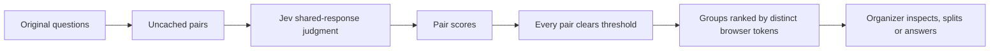

# How MergePoll groups questions

## One response as the criterion

Jev evaluates whether one natural, concise answer or the same concrete action
would satisfy a pair of posts, given the event title and context. It judges
likely answer coverage; it does not generate the answer.

Broader/narrower questions can merge when the narrower answer is naturally
covered by the same explanation. Different actions, species, locations,
timeframes or requested outcomes should stay separate when those details change
the required response. A forced umbrella answer that concatenates two separate
answers does not qualify.

## The pipeline

The current model is `jev-1.13.0`, with TypeSafe's Noul primitive. Requests are
batched in groups of up to 100 pair judgments. The implementation retries 429
and 529 responses, validates that every score is a number between 0 and 1,
and retains existing questions if a pass fails.

Clustering is greedy in question creation order. A new member must clear the
threshold against **every** existing member of its proposed group. This avoids
merging a whole chain merely because A matches B and B matches C. Creation
order can still affect the result; it is not a globally optimal partition.

Cached scores are reused. Changing event context clears prior decisions. Policy
migrations reset old scores without removing wording, votes, answered history
or manual split exclusions. Manual splits block those pairs from regrouping.

## Thresholds and metrics

The default 0.7 threshold is an experimental setting, not a measured 70% chance
that a group is correct. Pair probabilities are model outputs and have not been
calibrated against a representative event dataset.

The grouping lab compares the ten seed questions against predefined paraphrase
labels. Those labels are narrower than the shared-answer policy. Precision and
recall on this set are debugging aids, not product-wide accuracy claims. Any
displayed request-cost estimate uses an assumed rate and excludes other service
costs; consult TypeSafe's current pricing for billing.

## Scale and persistence

For `n` fresh questions, all-pairs evaluation needs `n(n−1)/2` decisions: 30
questions require 435 pairs, while 1,000 require 499,500. Batching and caching
reduce repeat work but do not change that initial growth. Large events need
candidate retrieval, load testing and limits before expanding the prototype.

Room JSON and a version counter are stored in D1. Updates use compare-and-swap
retries to avoid overwriting concurrent changes. Automatic cycles are triggered
by the Organizer browser, not by a server cron.

## Reference

[TypeSafe documentation](https://docs.typesafe.ai/) describes Noul judgments and
the model API. The exact project request is in [lib/grouping.ts](../lib/grouping.ts).
